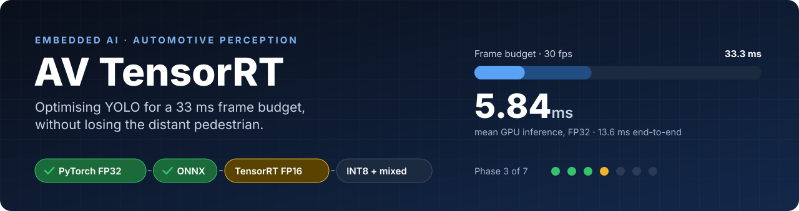
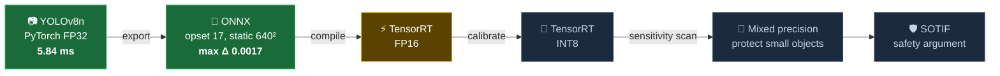
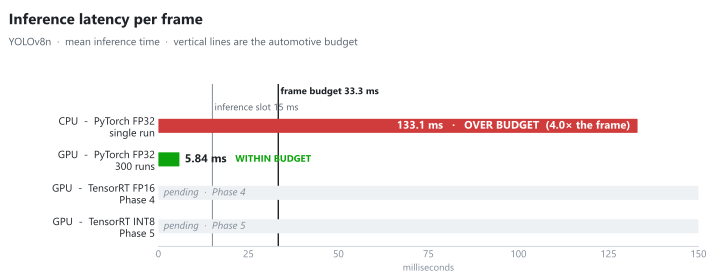
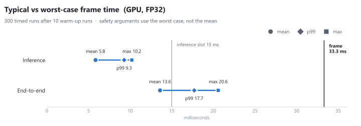
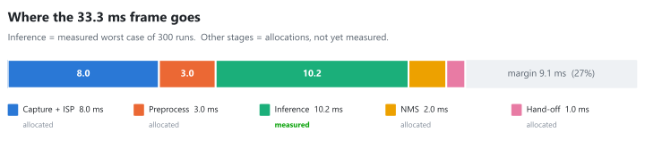
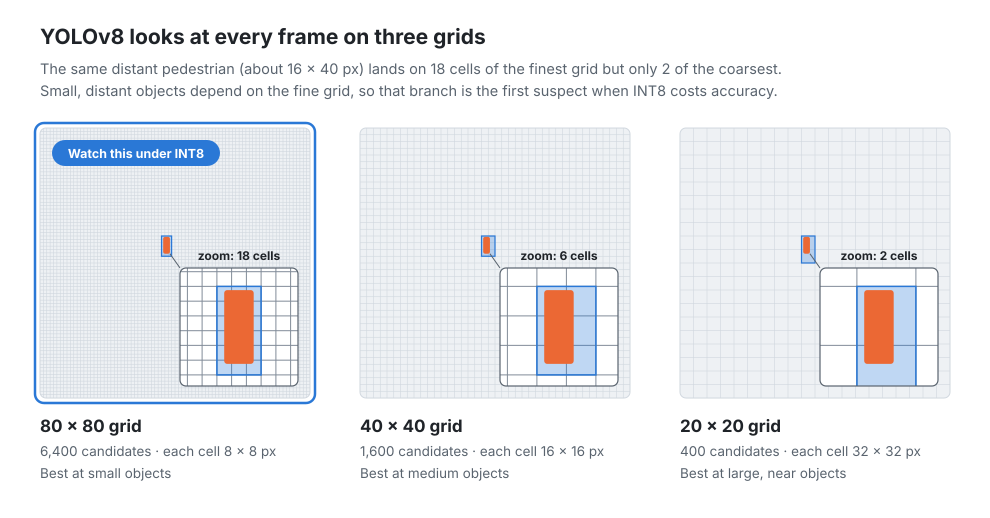

<p align="center">
  
</p>

<p align="center">
  
  
  
  
  
</p>
<p align="center">
  
  
  
  
</p>

<p align="center">
  <b>A systems and functional-safety engineer's approach to deploying AI perception:</b><br>
  baselines before optimisation, back-to-back tests for every conversion, and timing judged on the worst case.
</p>

<p align="center">
  <a href="#-the-pipeline">Pipeline</a> ·
  <a href="#-results">Results</a> ·
  <a href="#-why-distant-pedestrians-are-the-hard-part">Small objects</a> ·
  <a href="#-engineering-lens">Engineering lens</a> ·
  <a href="#-run-it-yourself">Run it</a>
</p>

---

## 🧭 The pipeline

Each stage must prove it is equivalent to the one before it, the same discipline as model-in-the-loop to software-in-the-loop testing on the V-Model.



| Phase | Goal | Status |
|:---:|---|:---:|
| 1 | Workstation, GPU and a 30 fps latency budget model | ✅ |
| 2 | FP32 GPU baseline with mean, p99 and worst-case timing | ✅ |
| 3 | ONNX export plus numerical equivalence test | ✅ |
| 4 | TensorRT FP16 engine | 🟡 next |
| 5 | TensorRT INT8 with calibration data | ⏳ |
| 6 | Layer sensitivity scan and mixed precision for small objects | ⏳ |
| 7 | Nsight profiling and SOTIF safety argument | ⏳ |

---

## 📊 Results

### From CPU to GPU: 133 ms down to 5.84 ms

<picture>
  <source media="(prefers-color-scheme: dark)" srcset="assets/latency_dark.svg">
  
</picture>

The CPU needed **4× the entire frame** for inference alone. The GPU brings it to 5.84 ms mean, before any optimisation. The empty rows fill in as Phases 4 and 5 land.

### Typical is not enough: the worst case is what gets argued

<picture>
  <source media="(prefers-color-scheme: dark)" srcset="assets/timing_spread_dark.svg">
  
</picture>

The slowest end-to-end frame took **1.5× the average**. **0 of 300** frames broke the 15 ms inference slot.

### Where the 33.3 ms goes

<picture>
  <source media="(prefers-color-scheme: dark)" srcset="assets/budget_dark.svg">
  
</picture>

> [!IMPORTANT]
> **Most of the frame time is now outside the neural network.** End-to-end averages 13.6 ms, but inference is only 5.8 ms. Once TensorRT shrinks inference further, preprocessing and postprocessing become the bottleneck, so they have to be budgeted and optimised too.

### ONNX export: proven faithful

| Check | PyTorch | ONNX | Verdict |
|---|:---:|:---:|:---:|
| Output shape | (1, 84, 8400) | (1, 84, 8400) | ✅ |
| Max absolute difference | | **0.001709** | ✅ about 1/600 of a pixel |
| Mean absolute difference | | **0.00000131** | ✅ |

> [!NOTE]
> A first comparison through Ultralytics showed **different detections** (6 vs 5 objects, a stop sign at 0.255 confidence vanished). Feeding both models an **identical** input tensor proved the export itself is faithful. The likely cause is preprocessing: the `.pt` path uses a rectangular input, the static ONNX path a padded square. **Lesson: preprocessing is part of the perception function, and low-confidence detections flip first.**

---

## 🎯 Why distant pedestrians are the hard part

<picture>
  <source media="(prefers-color-scheme: dark)" srcset="assets/detection_scales_dark.svg">
  
</picture>

INT8 stores each value with only 256 levels. Small, distant objects produce weak, subtle signals, the kind most easily rounded away. **Hypothesis for Phase 6:** the 80 × 80 branch will be the most quantisation-sensitive, and keeping its key layers in FP16 will recover small-object accuracy at little latency cost. That's a SOTIF functional insufficiency introduced by optimisation, not a fault.

---

## 🔧 Engineering lens

How each ML deployment idea maps to automotive systems practice:

| ML deployment | Automotive equivalent |
|---|---|
| 33 ms per frame at 30 fps | Cyclic task deadline on an ECU |
| ONNX file | Interface control document: neutral, tool-independent |
| TensorRT engine | Target-specific compiled build, valid for one GPU only |
| FP32 → FP16 → INT8 | Floating point → fixed point, with a proof the loss is acceptable |
| Equivalence test on raw outputs | Back-to-back testing (MiL vs SiL) |
| Warm-up runs discarded | Wait for steady state before measuring a sensor |
| p99 / max latency | Worst-case execution time, not average |
| Layer sensitivity scan | FMEA on the network: which layer's degradation hurts most? |
| Small-object accuracy drop after INT8 | SOTIF triggering condition / functional insufficiency |

---

## ⚠️ Honest limits of the evidence

> [!WARNING]
> - **One image, repeated.** Inference time barely depends on content, but NMS time grows with the number of detections. Varied scenes are needed.
> - **300 frames is not proof.** With 0 misses in 300 runs, the *rule of three* only supports a miss rate below ~1% at 95% confidence: potentially one missed deadline every 3–4 s at 30 fps.
> - **Laptop GPU, not DRIVE Orin/Thor.** The method transfers; the absolute numbers don't.
> - **Accuracy not yet measured on a dataset.** Phases 5–6 add COCO mAP, including small-object mAP.

---

## 🚀 Run it yourself

```powershell
python -m venv .venv
.venv\Scripts\activate
pip install torch torchvision --index-url https://download.pytorch.org/whl/cu128
pip install ultralytics onnx onnxslim onnxruntime

python check_gpu.py          # is the GPU visible?
python benchmark.py          # 300-run timing: mean, p99, max, deadline misses
python export_onnx.py        # PyTorch -> ONNX
python equivalence_test.py   # prove the ONNX file matches
```

> [!TIP]
> **Every chart in this README is generated from data.** All numbers live in [`results.json`](results.json). After each phase: update the file, run `python make_charts.py`, commit. The banner and every chart stay in sync with the evidence.

<details>
<summary><b>📁 Repository contents</b></summary>

| File | Purpose |
|---|---|
| `hello_budget.py` | 30 fps latency budget with margin and pass/fail |
| `check_gpu.py` | Confirms CUDA is available and reports compute capability |
| `first_detection_gpu.py` | First GPU detection; shows the warm-up effect |
| `benchmark.py` | 10 warm-up + 300 timed runs; mean, p99, max, deadline misses |
| `export_onnx.py` | YOLOv8n → ONNX (opset 17, static 640 × 640, simplified) |
| `compare_onnx.py` | Pipeline-level `.pt` vs `.onnx` detection comparison |
| `equivalence_test.py` | Raw-output back-to-back test with identical inputs |
| `make_charts.py` | Builds every README image from `results.json` (light + dark) |
| `results.json` | Single source of truth for all measured numbers |

</details>

<details>
<summary><b>🖥️ Test environment</b></summary>

| Item | Value |
|---|---|
| Laptop | Lenovo Legion 5 15IRX10, i7-13650HX, 32 GB RAM |
| GPU | NVIDIA GeForce RTX 5050 Laptop, 8 GB, Blackwell, compute capability 12.0 |
| Driver | 616.92 (supports CUDA 13.4) |
| Software | Python 3.10.0 · PyTorch 2.11.0+cu128 · Ultralytics 8.4.175 · ONNX 1.23.2 · ONNX Runtime 1.23.2 · onnxslim 0.1.98 |
| Conditions | Mains power, Lenovo Performance mode |

</details>

---

<p align="center">
  <b>Companion project:</b> <a href="https://github.com/Lalithprabu/sotif-cocoon">sotif-cocoon</a>, a runtime safety layer (plausibility checks + trust-score arbiter) wrapped around the same YOLOv8n model.<br><br>
  Built by <a href="https://github.com/Lalithprabu">Lalithprabu</a>: former Lead Systems Engineer (Vision Systems, Rear Wheel Steering) at JLR · Certified Functional Safety Engineer, ISO 26262 up to ASIL-D.
</p>
